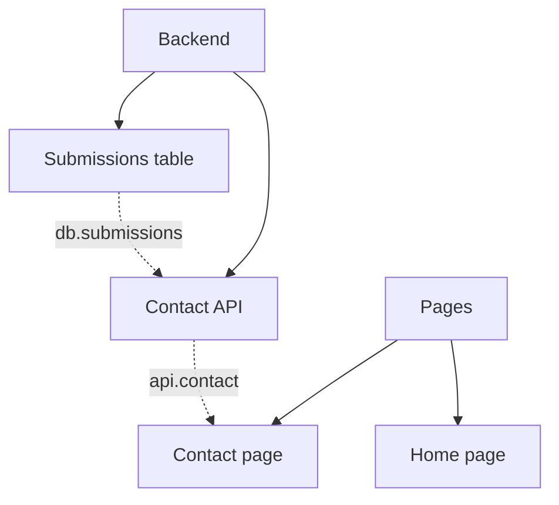

# The decomposition file

What `/hive:decomposition` writes and `hive:decomposition-reviewer` reads:
the contracts and blockers between nodes, the files a leaf touches, the
file's shape as the Hive parses it, and the check the skill runs before a
run ends. The skill says how the tree is built, the reviewer what no
parser catches; this text says only what the file holds.

## Contracts and blockers

`Delivers:` and `Consumes:` list stable contract ids, such as
`api.contact`, `db.submissions` or `finding.cdn-forms`. An id is lowercase
and dotted (`^[a-z][a-z0-9_-]*(\.[a-z0-9_-]+)*$`), and only one node
delivers a given contract.

Derive `Blocked by:` from the contracts. A node that consumes a contract
another node delivers is blocked by that node. Write both, the contracts
and the blockers. A `Blocked by` names only ids of the same file, never
the node itself, its ancestor or its descendant (the tree already orders
those), and never closes a cycle. If the contracts ask for one of those,
the split is wrong: restructure it.

## Files touched

A leaf may carry a `Touches:` line: a comma-separated list of the main
files or folders it changes, each a path relative to the repository,
without `..` (`Touches: functions/contact.ts, db/migrations`). Contracts
miss two leaves that edit the same file in parallel; `Touches:` catches
them. An inner node has no `Touches:`.

Two leaves overlap when a path of one equals a path of the other, or one
is a folder holding the other, and no `Blocked by` chain orders them. A
chain orders them when one of them, or one of its ancestors, is blocked,
directly or through other blockers, by the other leaf or one of its
ancestors. An overlap is a warning, not an error: order the two leaves,
merge them, or keep them and say why at the pause.

## The file

The decomposition file, exactly in this shape:

````markdown
# Site for XPTO
Label: decomposed
A marketing site with a contact form.



## Design
Static pages served by the CDN; one serverless function for the form. Errors as RFC 7807.

## 1 Backend
### Scope
In: the form's endpoint and its storage. Out: any admin view.

### Design
Submissions are stored in a single table; no queue.

Delivers:
Consumes:
Blocked by:

## 1.1 Submissions table
### Scope
In: the table and its migration. Out: any read API.

### Acceptance criteria
- the migration creates the table and `pnpm test` inserts and reads a row

Delivers: db.submissions
Consumes:
Blocked by:

## 1.2 Contact API
### Scope
In: POST /contact with validation. Out: spam filtering.

### Open points
- rate limit per IP or per session
- feasibility: the CDN's edge function accepts a POST body over 10 KB

### Acceptance criteria
- a valid POST /contact answers 201 and stores the row
- an invalid one answers 400 with the RFC 7807 body

Delivers: api.contact
Consumes: db.submissions
Touches: functions/contact.ts, db/migrations
Blocked by: 1.1

## 2 Pages
### Scope
In: the site's pages. Out: a blog.

Delivers:
Consumes: api.contact
Blocked by: 1

## 2.1 Contact page
### Scope
In: the form and its states. Out: other pages.

### Acceptance criteria
- submitting the form shows the success state with the API mocked

Delivers:
Consumes: api.contact
Blocked by: 1.2

## 2.2 Home page
### Scope
In: the landing page. Out: the contact form.

### Acceptance criteria
- the home page renders its hero and links to the contact page

Delivers:
Consumes:
Blocked by:

## Suggestions
- an admin view of the submissions
````

The rules the Hive reads it by:

- The first `# ` heading is the goal's title, and the text up to the first
  `##` is the goal's text.
- `Label:` is a line of the goal's text, at most once: the label every
  created issue gets, 1 to 50 characters; the Hive reads `none` as no
  label.
- `## Design` (the root's design) and `## Suggestions` are the only `##`
  headings that are not nodes. Every other `##` heading is
  `## <id> <title>`, with a title of 1 to 200 characters, and comes after
  its parent's.
- Inside a node, the text before the first `###` is its free text (it
  heads the issue). The only subsections are `### Scope` (required on
  every node), `### Design` (inner nodes only), `### Open points` (leaves
  only) and `### Acceptance criteria` (required on a leaf, never on an
  inner node).
- `Open points` and `Acceptance criteria` are `- ` item lists, with nothing
  after the list.
- `Delivers:`, `Consumes:`, `Touches:` and `Blocked by:` are lines of
  their own, each once per node, each a comma-separated list, which may be
  empty. `Touches:` goes on leaves only.
- A fenced block is never read for headings or markers.

### The diagram

The first fenced block, right after the goal's text, is a `mermaid`
`flowchart TD`. It has one box per node, named `n` plus its id with `_`
for `.` (`n1_2`) and labelled with its title. A solid `-->` goes from
parent to child, and a dotted `-.->|<contract>|` goes from the node that
delivers a contract to each node that consumes it, the contract between
pipes (the `-. <contract> .->` form breaks on an id with a hyphen). A
`Blocked by` with no contract behind it is a plain dotted `-.->`.

The diagram is a view: the Hive never reads it, and the sections are the
truth. Write it whole again at every revision, so it always matches them.

### Check before you end

Before ending a run, read the file back and check it the way the Hive
will:

- no duplicate or orphan id;
- every leaf has acceptance criteria and no design;
- no inner node has criteria or open points;
- the goal and every inner node have two children or more;
- every contract id is well formed, and each is delivered once;
- every `Blocked by` names an existing id, never itself, an ancestor or a
  descendant, and no cycle;
- 8 levels, 100 children and 300 nodes at most;
- every node comes after its parent;
- `Touches:` only on leaves, every path relative and without `..`;
- `Label:` at most once, 1 to 50 characters;
- no two leaves overlap (see "Files touched"); raise each overlap at a
  pause.

The Hive's confirm dialog refuses a file that breaks any of these, at its
line, except the overlaps, which it lists as warnings and writes anyway.
